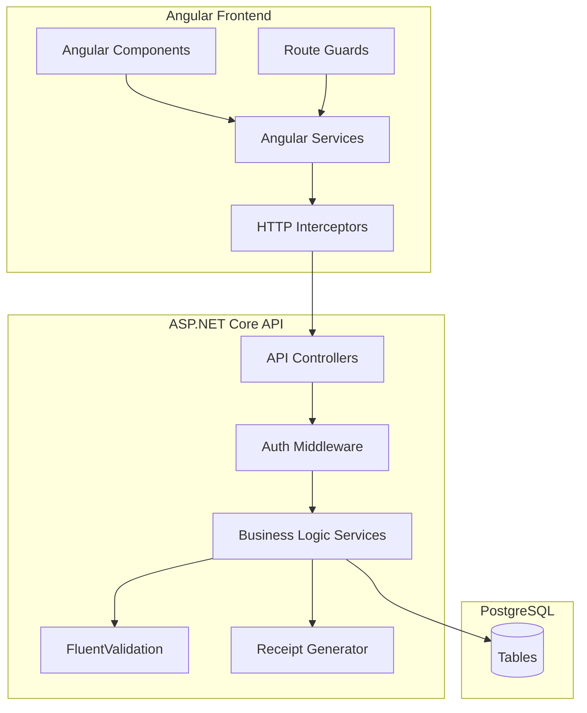
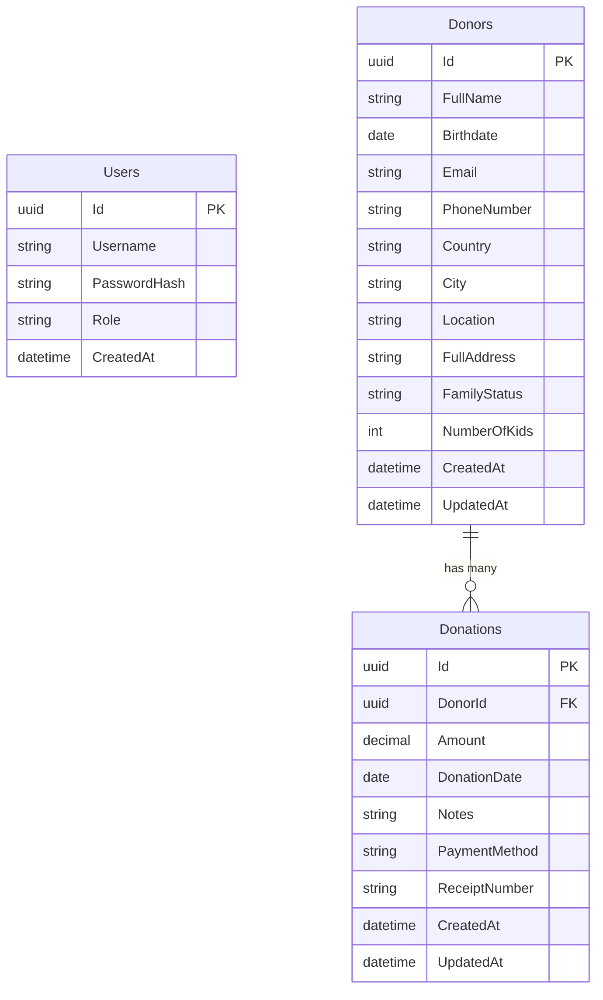

# Design Document: Donor Management

## Overview

The Donor Management Application is a full-stack web application for managing donor profiles, recording donations, generating receipts, and viewing analytics. It uses a layered architecture with an Angular frontend, C# ASP.NET Core Web API backend, and PostgreSQL database.

The system supports two user roles (Admin and Staff) with JWT-based authentication, provides PDF and Word receipt generation, and offers a responsive UI with search, filtering, and dashboard analytics.

## Architecture



### Architectural Decisions

| Decision | Choice | Rationale |
|----------|--------|-----------|
| API Style | REST | Simple CRUD operations, well-supported by Angular HttpClient |
| Auth | JWT Bearer Tokens | Stateless, scalable, works well with SPAs |
| ORM | Entity Framework Core | First-class .NET support, migrations, LINQ queries |
| PDF Generation | QuestPDF | Fluent API, no external dependencies, .NET native |
| Word Generation | DocumentFormat.OpenXml | Official Microsoft library, no Office installation needed |
| Validation (Backend) | FluentValidation | Declarative rules, testable, separation from models |
| Validation (Frontend) | Angular Reactive Forms | Built-in validators, real-time feedback |
| Password Hashing | ASP.NET Identity (PBKDF2) | Industry standard, built into framework |

## Components and Interfaces

### Backend Components

#### 1. AuthController
- `POST /api/auth/login` — Authenticate user, return JWT token
- `POST /api/auth/refresh` — Refresh expired token

#### 2. DonorController
- `GET /api/donors` — List donors with pagination, search, and filters
- `GET /api/donors/{id}` — Get donor by ID with donation history
- `POST /api/donors` — Create donor
- `PUT /api/donors/{id}` — Update donor
- `DELETE /api/donors/{id}` — Delete donor (cascades to donations)

#### 3. DonationController
- `GET /api/donors/{donorId}/donations` — List donations for a donor
- `POST /api/donors/{donorId}/donations` — Create donation
- `PUT /api/donations/{id}` — Update donation
- `DELETE /api/donations/{id}` — Delete donation

#### 4. ReceiptController
- `GET /api/donations/{donationId}/receipt/pdf` — Generate and download PDF receipt
- `GET /api/donations/{donationId}/receipt/docx` — Generate and download Word receipt

#### 5. DashboardController
- `GET /api/dashboard/summary` — Total donors, total donations amount
- `GET /api/dashboard/recent-donations` — Recent donations list
- `GET /api/dashboard/top-donors` — Top donors by total amount
- `GET /api/dashboard/monthly-stats` — Monthly donation stats for current year

#### 6. Business Logic Services

| Service | Responsibility |
|---------|---------------|
| `IDonorService` | Donor CRUD, search, filtering |
| `IDonationService` | Donation CRUD, receipt number generation |
| `IReceiptService` | PDF and Word receipt generation |
| `IDashboardService` | Aggregate statistics queries |
| `IAuthService` | Login, token generation, password verification |

#### 7. Validators (FluentValidation)

| Validator | Rules |
|-----------|-------|
| `DonorValidator` | Required: FullName, Email, Phone. Email format. Phone format. Kids >= 0. |
| `DonationValidator` | Amount > 0. Valid date. Valid payment method enum. |
| `LoginValidator` | Required: Username, Password. |

### Frontend Components

#### Angular Modules/Features

| Module | Components |
|--------|-----------|
| Auth | LoginComponent |
| Donors | DonorListComponent, DonorCardComponent, DonorFormComponent |
| Donations | DonationFormComponent, DonationListComponent |
| Receipts | ReceiptButtonComponent |
| Dashboard | DashboardComponent, StatsCardComponent, ChartComponent |
| Shared | NotificationComponent, ConfirmDialogComponent, SearchBarComponent, FilterPanelComponent |

#### Angular Services

| Service | Responsibility |
|---------|---------------|
| `AuthService` | Login, token storage, role checks |
| `DonorService` | HTTP calls for donor CRUD and search |
| `DonationService` | HTTP calls for donation CRUD |
| `ReceiptService` | HTTP calls for receipt download |
| `DashboardService` | HTTP calls for dashboard data |
| `NotificationService` | Toast notification display |

#### Guards and Interceptors

- `AuthGuard` — Redirects unauthenticated users to login
- `RoleGuard` — Blocks access based on user role
- `AuthInterceptor` — Attaches JWT token to outgoing requests
- `ErrorInterceptor` — Catches HTTP errors, triggers notifications

## Data Models

### Database Schema (PostgreSQL)



### Entity Models (C#)

```csharp
public class Donor
{
    public Guid Id { get; set; }
    public string FullName { get; set; }
    public DateOnly? Birthdate { get; set; }
    public string Email { get; set; }
    public string PhoneNumber { get; set; }
    public string Country { get; set; }
    public string City { get; set; }
    public string Location { get; set; }
    public string FullAddress { get; set; }
    public FamilyStatus FamilyStatus { get; set; }
    public int NumberOfKids { get; set; }
    public DateTime CreatedAt { get; set; }
    public DateTime UpdatedAt { get; set; }
    public ICollection<Donation> Donations { get; set; }
}

public class Donation
{
    public Guid Id { get; set; }
    public Guid DonorId { get; set; }
    public decimal Amount { get; set; }
    public DateOnly DonationDate { get; set; }
    public string? Notes { get; set; }
    public PaymentMethod PaymentMethod { get; set; }
    public string ReceiptNumber { get; set; }
    public DateTime CreatedAt { get; set; }
    public DateTime UpdatedAt { get; set; }
    public Donor Donor { get; set; }
}

public enum FamilyStatus { Single, Married, Divorced, Widowed }
public enum PaymentMethod { Cash, CreditCard, BankTransfer, Check, Other }
```

### DTOs

```csharp
public record CreateDonorRequest(
    string FullName,
    DateOnly? Birthdate,
    string Email,
    string PhoneNumber,
    string? Country,
    string? City,
    string? Location,
    string? FullAddress,
    FamilyStatus FamilyStatus,
    int NumberOfKids
);

public record CreateDonationRequest(
    decimal Amount,
    DateOnly DonationDate,
    string? Notes,
    PaymentMethod PaymentMethod
);

public record LoginRequest(string Username, string Password);
public record LoginResponse(string Token, string Role, DateTime Expiry);

public record DashboardSummary(int TotalDonors, decimal TotalDonations);
public record MonthlyStats(int Month, int Year, decimal Total, int Count);
```

### Search and Filter Model

```csharp
public record DonorSearchFilter(
    string? Query,              // Searches FullName, Email, Phone
    FamilyStatus? FamilyStatus,
    string? Location,
    decimal? MinAmount,
    decimal? MaxAmount,
    DateOnly? FromDate,
    DateOnly? ToDate,
    int Page = 1,
    int PageSize = 20
);
```


## Correctness Properties

*A property is a characteristic or behavior that should hold true across all valid executions of a system — essentially, a formal statement about what the system should do. Properties serve as the bridge between human-readable specifications and machine-verifiable correctness guarantees.*

### Property 1: Donor storage round-trip

*For any* valid donor data (with valid name, email, phone, family status, and non-negative kids), creating a donor and then retrieving it by ID should return a record with all fields matching the original input.

**Validates: Requirements 1.1, 1.2**

### Property 2: Donor validation rejects invalid input

*For any* donor creation request that is missing a required field (Full Name, Email, or Phone Number) or contains an invalid email format or invalid phone characters, the Validator should reject the request and return an error identifying the invalid field.

**Validates: Requirements 1.4, 13.1, 13.2, 13.3**

### Property 3: Donor update persistence

*For any* existing donor and any valid set of updated field values, submitting the update and then retrieving the donor should return the new values.

**Validates: Requirements 2.1**

### Property 4: Donor deletion cascades to donations

*For any* donor with zero or more associated donations, confirming deletion should result in neither the donor nor any of their donations being retrievable.

**Validates: Requirements 2.3**

### Property 5: Cancelled deletion preserves records

*For any* donor or donation, if a deletion request is initiated but cancelled, the record should remain unchanged (identical to its state before the deletion request).

**Validates: Requirements 2.4, 5.4**

### Property 6: Donation storage round-trip

*For any* valid donation data (positive amount, valid date, valid payment method) and any existing donor, creating a donation linked to that donor and then retrieving it should return a record with all fields matching the original input and the correct donor linkage.

**Validates: Requirements 4.1, 4.2**

### Property 7: Receipt number uniqueness

*For any* set of donations created in the system, all receipt numbers should be distinct (no two donations share the same receipt number).

**Validates: Requirements 4.3**

### Property 8: Donation amount validation

*For any* donation amount that is zero or negative, the Validator should reject the submission.

**Validates: Requirements 4.5, 13.4**

### Property 9: Donation update persistence

*For any* existing donation and any valid set of updated field values, submitting the update and then retrieving the donation should return the new values.

**Validates: Requirements 5.1**

### Property 10: Donation deletion removes record

*For any* existing donation, confirming deletion should result in the donation no longer being retrievable.

**Validates: Requirements 5.3**

### Property 11: PDF receipt contains required information

*For any* donation with an associated donor, generating a PDF receipt should produce a valid PDF document containing: the institution name, the donor's full name, the donation amount, the donation date, the receipt number, and the payment method.

**Validates: Requirements 6.1, 6.2, 6.3, 6.4**

### Property 12: Word receipt content parity with PDF

*For any* donation, the Word receipt should contain the same institution, donor, and donation information as the PDF receipt (institution name, donor full name, donation amount, date, receipt number, payment method).

**Validates: Requirements 7.1, 7.2**

### Property 13: Substring search returns matching donors

*For any* donor in the system and any substring of their Full Name, Email, or Phone Number, searching with that substring should include that donor in the results.

**Validates: Requirements 8.1, 8.2**

### Property 14: Combined filters use AND logic

*For any* combination of active filters (family status, location, amount range, date range), all donors in the result set should satisfy every active filter criterion simultaneously.

**Validates: Requirements 9.1, 9.2, 9.3, 9.4, 9.5**

### Property 15: Dashboard donor count accuracy

*For any* set of donors in the system, the dashboard total donors count should equal the actual number of donor records.

**Validates: Requirements 10.1**

### Property 16: Dashboard donation sum accuracy

*For any* set of donations in the system, the dashboard total donations amount should equal the sum of all donation amounts.

**Validates: Requirements 10.2**

### Property 17: Recent donations ordering

*For any* set of donations, the dashboard recent donations list should be sorted by donation date in descending order (most recent first).

**Validates: Requirements 10.3**

### Property 18: Top donors ranking

*For any* set of donors with donations, the top donors list should be sorted by total donation amount in descending order.

**Validates: Requirements 10.4**

### Property 19: Monthly stats aggregation

*For any* set of donations in the current year, the monthly statistics for each month should equal the sum and count of donations with a donation date in that month.

**Validates: Requirements 10.5**

### Property 20: Authentication with valid credentials succeeds

*For any* registered user, authenticating with their correct username and password should return a valid JWT token.

**Validates: Requirements 11.1**

### Property 21: Authentication with invalid credentials fails

*For any* username and password combination where the password does not match the stored hash, authentication should be denied.

**Validates: Requirements 11.2**

### Property 22: Passwords are never stored in plaintext

*For any* user in the system, the stored password value should not equal the original plaintext password and should match a recognized hash format.

**Validates: Requirements 11.3**

### Property 23: Role-based access enforcement

*For any* API endpoint with a role restriction and any authenticated user whose role does not include that endpoint's required permission, the system should return a 403 Forbidden response.

**Validates: Requirements 12.2, 12.3, 12.4, 15.3**

### Property 24: Unauthenticated requests are rejected

*For any* API endpoint (except the login endpoint), a request without a valid authentication token or with an expired/malformed token should receive a 401 Unauthorized response.

**Validates: Requirements 15.1, 15.2**

## Error Handling

### Backend Error Strategy

| Scenario | HTTP Status | Response Body |
|----------|-------------|---------------|
| Validation failure | 400 Bad Request | `{ errors: { field: ["message"] } }` |
| Invalid credentials | 401 Unauthorized | `{ error: "Invalid username or password" }` |
| Expired/missing token | 401 Unauthorized | `{ error: "Authentication required" }` |
| Insufficient role | 403 Forbidden | `{ error: "Access denied" }` |
| Entity not found | 404 Not Found | `{ error: "Donor not found" }` |
| Unexpected error | 500 Internal Server Error | `{ error: "An unexpected error occurred" }` |

### Backend Implementation

- Global exception middleware catches unhandled exceptions and returns 500
- FluentValidation pipeline behavior returns 400 with field-level errors
- Service layer throws typed exceptions (`NotFoundException`, `ValidationException`)
- All errors are logged with correlation IDs for tracing

### Frontend Error Strategy

- `ErrorInterceptor` catches HTTP errors and routes them to `NotificationService`
- 401 responses trigger automatic redirect to login
- 403 responses show "Access Denied" notification
- 400 responses map field errors back to form controls
- 500 responses show generic "Something went wrong" notification
- Network errors show "Connection lost" notification with retry option

## Testing Strategy

### Unit Tests

Unit tests cover specific examples, edge cases, and integration points:

- **Validators**: Test specific valid/invalid inputs (empty name, malformed email, negative amount)
- **Services**: Test business logic with mocked repositories (donor creation, deletion cascade)
- **Controllers**: Test HTTP response codes and response shapes
- **Receipt generation**: Test with specific donor/donation data, verify output format
- **Dashboard calculations**: Test with known data sets, verify exact totals

### Property-Based Tests

Property-based tests verify universal properties across randomized inputs. Use **FsCheck** (with xUnit) for the .NET backend.

Configuration:
- Minimum 100 iterations per property test
- Each test tagged with: `Feature: donor-management, Property {number}: {property_text}`
- Custom generators for valid/invalid donor data, donation data, and search queries

Property tests to implement (one test per design property):

| Property | Test Description |
|----------|-----------------|
| 1 | Generate random valid donors, create and retrieve, assert field equality |
| 2 | Generate random invalid donor requests (missing fields, bad email/phone), assert rejection |
| 3 | Generate random donors then random valid updates, assert updated fields match |
| 4 | Generate donors with random donations, delete donor, assert all gone |
| 5 | Generate donors/donations, initiate then cancel deletion, assert unchanged |
| 6 | Generate random valid donations for random donors, create and retrieve, assert field equality |
| 7 | Generate multiple donations, collect receipt numbers, assert all unique |
| 8 | Generate random non-positive amounts, assert validation rejection |
| 9 | Generate donations then random valid updates, assert updated fields match |
| 10 | Generate donations, delete, assert not retrievable |
| 11 | Generate random donors/donations, generate PDF, assert contains required text |
| 12 | Generate random donors/donations, generate Word doc, assert same content as PDF |
| 13 | Generate random donors, pick random substrings of their fields, search, assert donor in results |
| 14 | Generate random donors with donations, apply random filter combinations, assert all results satisfy all filters |
| 15 | Generate random donor sets, query dashboard count, assert equals actual count |
| 16 | Generate random donation sets, query dashboard sum, assert equals actual sum |
| 17 | Generate random donations, query recent list, assert sorted by date descending |
| 18 | Generate random donors with donations, query top donors, assert sorted by total descending |
| 19 | Generate random donations in current year, query monthly stats, assert per-month totals match |
| 20 | Generate random users with known passwords, authenticate, assert token returned |
| 21 | Generate random users, attempt login with wrong passwords, assert denial |
| 22 | Generate random users, inspect stored password field, assert not plaintext |
| 23 | Generate random role/endpoint combinations outside permissions, assert 403 |
| 24 | Generate random endpoints (except login), send without token, assert 401 |

### Test Libraries

| Layer | Library |
|-------|---------|
| Backend Unit Tests | xUnit + Moq |
| Backend Property Tests | FsCheck.Xunit |
| Backend Integration Tests | WebApplicationFactory (in-memory) |
| Frontend Unit Tests | Jasmine + Karma (Angular default) |
| Frontend E2E Tests | Cypress (optional, for UI flows) |

### Test Organization

```
tests/
├── DonorManagement.UnitTests/
│   ├── Validators/
│   ├── Services/
│   └── Controllers/
├── DonorManagement.PropertyTests/
│   ├── Generators/
│   ├── DonorProperties.cs
│   ├── DonationProperties.cs
│   ├── ReceiptProperties.cs
│   ├── SearchProperties.cs
│   ├── DashboardProperties.cs
│   └── AuthProperties.cs
└── DonorManagement.IntegrationTests/
    └── ApiTests/
```
